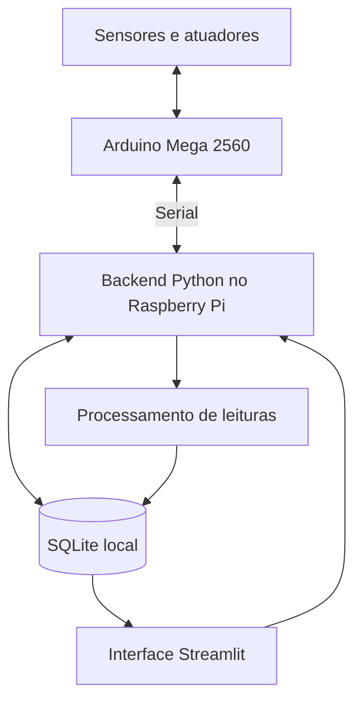

# HydroTwin 🌱

Sistema local de monitoramento e supervisão de cultivo hidropônico pela técnica NFT (*Nutrient Film Technique*), desenvolvido como Trabalho de Conclusão de Curso (TCC).

O software integra a comunicação com um Arduino, persistência local em SQLite, rotinas de análise das leituras e uma interface de supervisão construída com Streamlit. A arquitetura foi pensada para execução local em um computador de desenvolvimento ou Raspberry Pi.

> **Escopo real:** o software de supervisão calcula estados operacionais a partir de pH e condutividade elétrica (EC), calcula indicadores separados de anomalias e tendências e apresenta os resultados na interface. O firmware C++ do Arduino Mega realiza a aquisição local, envia telemetria, recebe parâmetros e executa rotinas de controle de iluminação e dosagem nutricional. Conforme informado pela equipe, os sensores, a comunicação serial bidirecional e os atuadores foram ajustados e testados no protótipo. Isso não significa que todos os cenários de falha ou a eficácia agronômica de cada estratégia tenham sido exaustivamente validados.

## Conteúdo

- [Objetivo e escopo acadêmico](docs/projeto.md)
- [Arquitetura](docs/arquitetura.md)
- [Organização do código e regras de negócio](docs/software.md)
- [Interface e guia de uso](docs/interface.md)
- [Protocolo de comunicação](docs/protocolo-comunicacao.md)
- [Firmware do Arduino](docs/firmware.md)
- [Instalação e execução](docs/instalacao.md)
- [Implantação no Raspberry Pi](docs/raspberry-pi.md)
- [Validação, testes e limitações](docs/validacao.md)

## Arquitetura resumida



O backend é iniciado pelo `main.py`. O módulo de comunicação gerencia o transporte, a leitura das mensagens, a fila de escrita no banco, o processamento periódico e a fila de envio de parâmetros. A comunicação serial com o Arduino físico foi validada conforme informado pela equipe; o modo TCP também existe no código, principalmente para testes e simulação. O transporte é definido por `TRANSPORT_MODE`.

## Funcionalidades presentes no código

- Login, criação de conta por convite e perfis `admin` e `viewer`.
- Cadastro e gestão de bancadas e filetes de cultivo.
- Cadastro de parâmetros de culturas.
- Recepção e armazenamento de telemetria.
- Processamento de estatísticas por janela horária.
- Classificação operacional por pH e EC.
- Cálculo de indicadores de anomalia e tendência.
- Registro e visualização de alertas operacionais.
- Envio de parâmetros de cultura ao Arduino com espera de confirmação.
- Firmware embarcado para leitura dos sensores, telemetria e controle local de iluminação e dosagem nutricional.
- Simulador de telemetria para desenvolvimento.
- Logs no terminal e em arquivo; envio de logs críticos por e-mail quando SMTP está configurado.

A disponibilidade de páginas e ferramentas depende do perfil de acesso e do ambiente configurado.

## Tecnologias

- Python (o `pyproject.toml` declara Python `>=3.9`)
- Streamlit
- SQLite
- pandas
- pySerial
- python-dotenv
- requests e uvicorn (dependências declaradas no projeto)
- pytest (dependência opcional de desenvolvimento)

### Acesso remoto

Durante a experimentação do protótipo, a interface do HydroTwin é disponibilizada para acesso remoto por meio do [ngrok,](https://ngrok.com/) que estabelece um túnel entre um enderço externo e o serviço Streamlit executado localmente no Raspberry Pi 4.

Essa configuração permite acompanhar as informações das bancadas por meio de um navegador, sem exigir que o dispositivo de acesso esteja na mesma rede do sistema local.

O uso do ngrok é opcional: a aplicação pode ser acessada diretamente pela rede local, desde que o serviço esteja configurado para isso. O túnel não participa da aquisição, do processamento nem do armazenamento dos dados.

## Início rápido

```bash
git clone https://github.com/acramin/HydroTwin.git
cd HydroTwin
python -m venv .venv
```

Ative o ambiente virtual e instale o projeto:

**Linux / Raspberry Pi**

```bash
source .venv/bin/activate
python -m pip install --upgrade pip
python -m pip install -e .
```

**Windows PowerShell**

```powershell
.\.venv\Scripts\Activate.ps1
python -m pip install --upgrade pip
python -m pip install -e .
```

Crie um `.env` a partir de `.env.example`, revise as variáveis e inicie a aplicação:

```bash
streamlit run main.py
```

Consulte [Instalação e execução](docs/instalacao.md) antes de iniciar uma instalação com dados persistentes. **Não execute a inicialização destrutiva do banco em um ambiente que contenha dados que você deseja preservar.**

## Estrutura do repositório

```text
.
├── main.py
├── app/
│   ├── pages/             # Páginas Streamlit
│   ├── components/        # Componentes reutilizáveis da interface
│   └── assets/            # Imagens e recursos visuais
├── src/hydrotwin/
│   ├── authentication/    # Login, sessões, convites e permissões
│   ├── communication/     # Leitura, envio, filas e protocolo
│   ├── db/                # Conexão, inicialização e CRUD SQLite
│   ├── helpers/           # Configuração, logs e formatação
│   ├── processing/        # Estado operacional, anomalias e tendências
│   ├── tools/             # Simuladores e geradores de dados
│   └── transport/         # Interfaces serial e TCP
├── script/
│   └── start.sh.example
├── depoly/
│   └── hydrotwin.service.example
├── pyproject.toml
├── requirements.txt
└── .env.example


```

## Configuração e segurança

- Não versione `.env`, senhas, chaves de sessão ou credenciais SMTP.
- O `.env.example` é um modelo: substitua os valores ilustrativos.
- O modo `DEVELOPMENT` permite login automático como administrador quando as credenciais configuradas correspondem ao administrador existente. Não use esse comportamento em uma instalação de produção.
- O banco SQLite fica sob `src/hydrotwin/db/`, pois o caminho é construído a partir do diretório do módulo. O nome efetivo vem de `DB_NAME` ou do padrão selecionado pelo modo de execução.
- O comando `python -m hydrotwin.db.init_db` pode apagar e recriar tabelas no modo `DEVELOPMENT`. Leia as instruções antes de executá-lo.

## Estado da documentação

Esta documentação descreve o software Python analisado e o firmware C++ fornecido pela equipe. Os testes físicos descritos como validados refletem as informações fornecidas pela equipe; não foram repetidos durante a revisão documental. Consulte [Firmware do Arduino](docs/firmware.md) e [Validação e limitações](docs/validacao.md).

## Contexto acadêmico

O HydroTwin integra um projeto de TCC sobre monitoramento e supervisão de cultivo hidropônico NFT. A fundamentação teórica, os objetivos aprovados e os resultados experimentais devem ser citados a partir da versão final do artigo acadêmico. Dados bibliográficos completos devem ser acrescentados quando confirmados; não os inferir a partir do nome do repositório.
