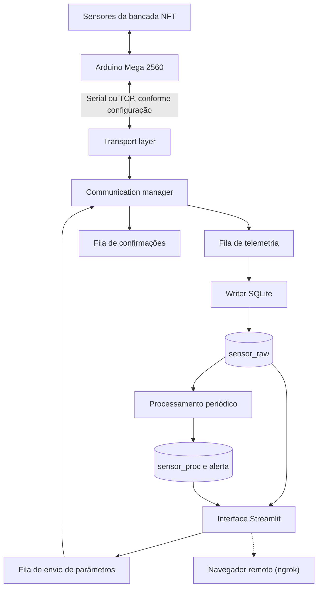

# Arquitetura do sistema

## Visão geral

O HydroTwin separa aquisição e controle embarcado da supervisão computacional. O Arduino Mega recebe os sinais de campo e executa o firmware; o backend Python recebe mensagens, mantém as filas de comunicação e persistência, processa leituras e oferece funções usadas pela interface Streamlit.

A comunicação serial bidirecional e o funcionamento dos sensores e atuadores foram confirmados pela equipe no protótipo. Essa validação não equivale a ensaios exaustivos de recuperação de falhas, segurança em todas as condições ou eficácia agronômica.

## Acesso remoto à aplicação

A arquitetura do HydroTwin mantém a aquisição, o processamento e a persistência dos dados no ambiente local, utilizando o Raspberry Pi 4 como plataforma de execução. O Streamlit disponibiliza a interface de monitoramento, enquanto o SQLite armazena os dados utilizados pela aplicação.

Durante a experimentação, o acesso remoto à interface é realizado por meio do ngrok. O serviço cria um túnel que encaminha as requisições recebidas em um endereço externo para o serviço Streamlit em execução no Raspberry Pi.

O ngrok atua exclusivamente como mecanismo de conectividade para a interface. Ele não substitui a comunicação entre o Arduino e o Raspberry Pi, não executa o processamento dos dados e não é responsável pela persistência no banco de dados.

A utilização do túnel é uma opção de implantação. Sem ele, o sistema continua operando localmente, e a interface pode ser acessada pela própria máquina ou por dispositivos da rede local, conforme a configuração de rede e do serviço.

## Camadas

### 1. Firmware e bancada

O Arduino é responsável pela aquisição e pelas rotinas embarcadas. O firmware fornecido implementa duas bancadas lógicas (B1 e B2). Para cada bancada, envia sete valores: pH, EC, temperatura ambiente, umidade relativa, temperatura da água, luminosidade e estado da boia de nível. O fluxo de água não é lido nem transmitido por este firmware. A sequência de campos é interpretada pelo parser Python e deve permanecer sincronizada entre as duas partes.

### 2. Transporte

`src/hydrotwin/transport/` define a interface de transporte e implementa:

- `SerialTransport`, para comunicação serial;
- `TCPServerTransport`, que aguarda a conexão de um cliente;
- `TCPClientTransport`, para iniciar uma conexão a um servidor.

O gerenciador seleciona serial ou servidor TCP com base em `TRANSPORT_MODE`. O modo TCP do gerenciador usa `0.0.0.0:65432`; o modo serial usa `/dev/ttyACM0` a 9600 baud. O firmware também inicia a serial a 9600 baud. A comunicação serial física foi validada pela equipe; os valores fixos no backend podem exigir alteração em outras instalações.

### 3. Gerenciamento da comunicação

`communication/manager.py` inicia workers para conexão/reconexão, leitura, envio de parâmetros, escrita no banco, processamento periódico e monitoramento de comunicação. Um evento de prontidão coordena os workers dependentes da conexão.

### 4. Banco de dados

`db/conn.py` abre conexões SQLite. `db/crud/base/create.py` define o esquema e índices. As funções de CRUD ficam em `db/crud/`. O arquivo de banco é localizado sob o diretório `src/hydrotwin/db/`; `DB_NAME` determina o nome/caminho configurado, e o padrão muda conforme o ambiente.

### 5. Processamento

`processing/estado_operacional.py` avalia pH e EC contra limites ideais e de atenção. `processing/anomalias.py` compara a leitura mais recente com a média recente. `processing/tendencias.py` compara médias de duas janelas consecutivas. `db/crud/sensor.py` reúne os resultados e persiste a agregação e os alertas.

### 6. Interface

`main.py` inicia o backend em uma thread com `st.cache_resource`, abre a conexão com o banco, configura autenticação e navegação e mostra o status de comunicação. As páginas e componentes estão em `app/pages/` e `app/components/`.

## Fluxo de telemetria

1. O microcontrolador envia uma linha terminada por nova linha.
2. O leitor tenta reconhecer uma confirmação de parâmetro, telemetria, cadastro de controlador ou mensagem de depuração.
3. A telemetria válida é interpretada pelo parser e colocada em `fila_dados`.
4. O worker de banco grava a leitura em `sensor_raw`.
5. A bancada é marcada como ativa para processamento.
6. O processamento periódico lê dados recentes e grava estatísticas, scores e alertas.
7. A interface consulta os dados brutos, processados e alertas.

## Fluxo de configuração

A interface pode enfileirar uma solicitação de envio contendo `bancada_id` e `cultura_id`. O worker busca os parâmetros da cultura no banco, formata a mensagem, envia pelo transporte e aguarda uma confirmação `PARAMS_OK` ou `PARAMS_ERROR`. O timeout de confirmação configurado no sender é de 10 segundos.

## Persistência e integridade

As tabelas usam chaves estrangeiras declaradas no esquema. O código de conexão ativa `sqlite3.connect`, mas não habilita `PRAGMA foreign_keys=ON` em cada conexão; a inicialização do esquema executa o pragma em sua própria conexão. A integridade referencial em todas as operações deve ser validada antes de ser considerada garantida.

## Falhas a validar

- Arduino desconectado ou reiniciado;
- mensagens inválidas ou truncadas;
- fila cheia;
- falha de gravação SQLite;
- perda de conexão durante envio de parâmetros;
- processo reiniciado durante processamento;
- banco sem permissão de escrita;
- diferença entre relógio do Raspberry Pi e timestamp do banco.

O status da comunicação é calculado a partir do horário da última leitura persistida e usa 1200 segundos como limiar em `db/crud/comunicacao.py`.
